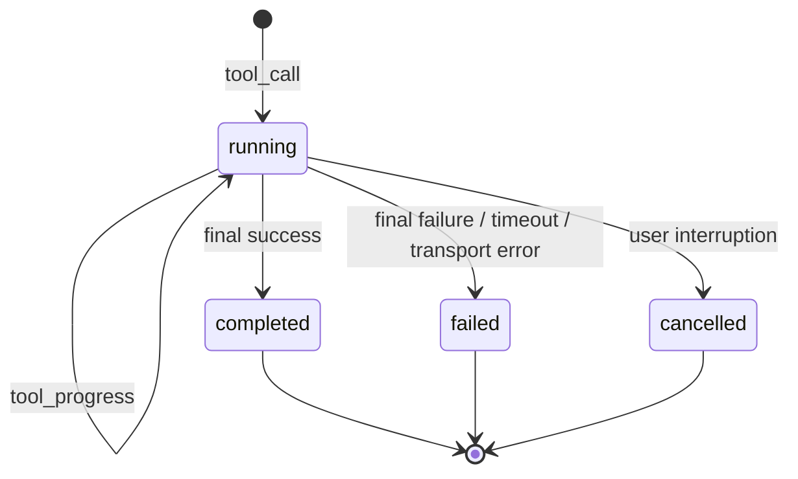

# KunCode 终端状态、运行环境与进度提示优化计划

> 状态：已实施并完成运行时激活；待用户完成真实浏览器验收  
> 编制日期：2026-08-07  
> 适用范围：Auto / KunCode 对话模式、KunCode 流式执行、终端面板、文件生成任务、Linux Docker 沙箱  
> 核心目标：让每次工具调用实时、准确地进入独立终态；保留可诊断的失败尝试；明确沙箱运行环境；为依赖安装、自动修复和文件验证提供可信的阶段提示。

## 1. 背景与已确认现状

本计划针对以下三个问题：

1. KunCode 已经成功生成文件，但终端仍可能显示红色 `ERROR`；同时需要确认工具是否真正实时结束。
2. KunCode 输出中频繁出现 `/root`、`/workspace`、Bash 和 Linux 命令，容易让用户误以为系统错误地把 Windows 宿主机当成 macOS/Linux。
3. 文件生成耗时较长时，用户无法区分模型正在处理、正在安装依赖、正在修复脚本还是正在验证文件。

最近一次代表性任务已经验证：

- SSE 实时链路正常，任务执行期间前端持续收到 `tool_result` 进度事件；问题不在“完全没有实时更新”。
- KunCode 前两次脚本执行产生 `Traceback`，随后自动修改脚本并成功生成、验证文件。
- 后端最终仍扫描到累计输出中的历史 `Traceback`，将整个调用错误地标记为 `failed`。
- `TerminalPanel` 会优先信任后端 `execution_status`，因此后端误判会直接表现为终端标红。
- 日志中确实出现了依赖解析和下载，但总耗时还包括脚本失败、自动修复、重复运行和结果验证，不能一律显示为“正在安装依赖”。

因此，当前状态应准确描述为：**实时传输已经可用，最终状态语义和阶段可观测性仍需完善。**

## 2. 已确认的产品决策

### 2.1 多次独立调用可以分别失败和成功

每一次顶层 `run_kuncode` 调用都以稳定且唯一的 `tool_id` 作为生命周期边界：

| 场景 | 终端显示 |
| --- | --- |
| 第一次 KunCode 调用真实失败 | 第一条调用标红，终态为 `failed` |
| 第二次 KunCode 调用真实失败 | 第二条调用标红，终态为 `failed` |
| 第三次 KunCode 调用成功 | 第三条调用标绿，终态为 `completed` |
| 前两次失败、第三次成功 | 保留三条真实记录，不把前两条改绿，也不因前两条失败把第三条改红 |

这类显示是可接受且推荐的，因为它忠实反映了 DataPM 发起的多次独立工具调用。

### 2.2 单次调用内部重试采用分层状态

如果一次 `run_kuncode` 调用内部执行脚本、修复错误并重试：

- 顶层工具卡在执行期间保持 `running`。
- 展开日志或内部调用列表可将失败尝试标红，并保留 `Traceback` 供诊断。
- 后续修复成功并完成最终交付时，顶层调用标记为 `completed`。
- 只有最终退出仍失败、超时、中断或连接异常时，顶层调用才标记为 `failed/cancelled`。

换言之，**历史失败尝试不等于最终工具失败**。

### 2.3 保留 Linux Docker 沙箱，不改成 Windows 执行环境

项目的宿主机是 Windows，用户代码和 KunCode 则在 Linux Docker 沙箱中运行。`/root`、`/workspace` 和 Bash 都是容器内部行为，不是宿主机识别错误。

本计划明确：

- 不把 KunCode 改成直接在 Windows 宿主机执行。
- 不让模型生成的 Shell/Python 绕过沙箱在宿主机执行。
- 保留 Linux 容器带来的隔离性、可重复性和 AgentScope Runtime 兼容性。
- 通过提示词、终端文案和路径展示明确区分“Windows 宿主机”和“Linux 执行沙箱”。
- 将“容器改为非 root 用户”作为后续安全加固项，不与本次状态和进度修复强绑定。

### 2.4 进度提示来源于运行时，不伪装成模型思考

“正在安装依赖”属于确定性的执行状态，不是模型推理内容。本计划不把这类提示写入思考文本，也不持续追加为聊天消息。

推荐形态：

- 终端工具卡顶部显示当前阶段，并原位更新。
- 聊天输入区上方可同步显示一条临时状态，但不持久化为普通对话消息。
- 任务完成后临时状态变为“已完成”并收起，历史回放只保留工具最终状态和必要日志。

## 3. 根因定位

### 3.1 最终状态仍依赖累计文本猜测

`app/services/agent_service.py` 中 `_tool_output_failed()` 会扫描完整累计输出中的：

- `[ERROR]`
- `Traceback`
- `Exception`
- 少量固定的成功关键词

当输出包含“先报错、后修复、最终成功”时，如果最终文案是 `Done. Generated` 等未覆盖表达，历史错误可能压过最终成功结果。

直连模式 `_direct_run_kuncode()` 目前还存在更简单的判断：只要累计输出包含 `[ERROR]` 就标记失败。这与 Auto 模式的判定口径不一致，也会误伤已经恢复的任务。

### 3.2 容器已掌握进程结果，但结果未完整传到终端协议

`sandbox_image/routers/kuncode_stream.py` 可以获得 KunCode 子进程的真实 `return_code`，并发送 `[DONE]` 或 `[ERROR]`；`data_analysis_sandbox.py` 最后也会创建带 `metadata.success` 的 `ToolResponse`。

但上层终态仍主要从文本重新推断，没有把以下结构化事实贯穿到底：

- 是否正常退出
- 退出码
- 是否超时
- 是否被用户取消
- 是否发生传输异常
- 最终结果是否成功

### 3.3 进度和最终结果复用同一种事件语义

当前中间流块和最终结果都使用 `tool_result`，仅通过 `phase`、`execution_status` 区分。这可以工作，但容易出现以下问题：

- 中间块被旧客户端当成终态。
- 最终块缺失时工具永久 `running`。
- 累积输出频繁覆盖，状态与原始日志耦合。
- 无法单独表达“正在安装依赖”“正在自动修复”等阶段。

### 3.4 用户看到了容器实现细节，但缺少环境说明

沙箱镜像本身就是 Linux，KunCode CLI、工具和 Skill 也主要使用 POSIX 路径。当前系统提示词虽然规定工作目录为 `/workspace`，但没有在每次 KunCode 任务上下文和用户界面中清楚解释：

- 宿主机：Windows。
- 执行环境：Linux Docker 容器。
- `/root`、`/workspace`：容器路径，不是 Windows 文件路径。
- 最终交付路径：相对 `/workspace` 的项目路径，不应向用户暴露容器配置目录。

## 4. 目标状态协议

### 4.1 顶层工具调用状态机



约束：

1. 同一个调用的所有事件必须使用同一个 `tool_id`。
2. 每个 `tool_id` 必须且只能进入一次最终状态。
3. `completed`、`failed`、`cancelled` 都是不可被普通进度事件覆盖的终态。
4. 任务回合结束时不得把所有历史调用批量改成同一种状态。
5. `end` 到达前应关闭所有仍未决的调用；拿不到真实结果时保守标记为失败或取消，禁止伪装成功。

### 4.2 建议事件契约

保留现有 `tool_call` 和最终 `tool_result`，新增语义明确的 `tool_progress`：

```json
{
  "type": "tool_progress",
  "tool_id": "call_xxx",
  "phase": "progress",
  "execution_status": "running",
  "stage": "dependency_installing",
  "message": "正在安装任务所需依赖",
  "attempt_index": 2
}
```

最终结果使用：

```json
{
  "type": "tool_result",
  "tool_id": "call_xxx",
  "phase": "completed",
  "execution_status": "completed",
  "success": true,
  "exit_code": 0,
  "content": "...",
  "generated_files": ["results/example.xlsx"]
}
```

失败结果使用相同结构，并增加稳定的 `error_code`，例如：

- `KUNCODE_NONZERO_EXIT`
- `KUNCODE_IDLE_TIMEOUT`
- `KUNCODE_STREAM_INCOMPLETE`
- `KUNCODE_CANCELLED`
- `KUNCODE_EMPTY_OUTPUT`

如果暂时不新增事件类型，可先让 `tool_result + phase=progress` 携带 `stage/message` 作为兼容过渡；最终目标仍应把“过程”和“结果”语义分开。

### 4.3 最终状态权威顺序

终态必须按以下优先级判定：

1. 用户取消、服务端取消标记。
2. KunCode 进程退出码、超时和传输异常等结构化运行结果。
3. 最终 `ToolResponse.metadata.success` 或等价的终态控制信息。
4. 兼容旧历史时，才回退到最终输出尾部和有限文本规则。

禁止继续使用“完整累计输出中只要曾经出现 `[ERROR]`/`Traceback` 就失败”的规则。

生成文件存在可作为成功结果的交叉验证，但不能单独覆盖明确的非零退出、取消或传输错误。

## 5. 运行阶段设计

### 5.1 标准阶段

| `stage` | 用户文案 | 触发依据 |
| --- | --- | --- |
| `sandbox_preparing` | 正在准备隔离执行环境 | 正在连接、创建、恢复或注入沙箱 |
| `model_processing` | KunCode 正在分析任务 | 进程已启动，尚未进入更具体阶段 |
| `dependency_checking` | 正在检查任务依赖 | 出现依赖解析、锁文件检查等真实信号 |
| `dependency_installing` | 正在安装任务所需依赖 | 出现下载、安装、解压或包管理器安装信号 |
| `file_generating` | 正在生成文件 | 出现 Write/Edit、导出或明确文件写入信号 |
| `repairing` | 执行出现问题，正在自动修复并重试 | 本调用出现错误后又发生编辑或重新执行 |
| `validating` | 正在验证输出结果 | 出现 validate、verify、检查行数/格式等信号 |
| `finalizing` | 正在整理并交付结果 | 已完成执行，正在提取生成文件和保存消息 |
| `completed` | 已完成 | 最终成功 |
| `failed` | 执行失败 | 最终失败 |
| `cancelled` | 已取消 | 用户中断 |

### 5.2 阶段识别原则

- 优先由沙箱路由和执行适配器主动发出结构化阶段。
- 对 KunCode 只能提供文本的部分，使用集中式、可测试的阶段解析器，不在 React 组件中重复写关键词规则。
- 只有检测到实际依赖行为时才显示“正在安装依赖”；普通模型等待不能冒充安装。
- 同一阶段只在状态变化时发送一次，避免每个字符都产生状态事件。
- 长时间无新阶段时可发送低频心跳，但不追加聊天消息。
- SSE 重连后应从 Redis Stream 回放当前阶段；前端按 `event_id` 去重并原位恢复。

### 5.3 前端展示

终端卡片建议显示：

```text
KunCode                         RUNNING
正在安装任务所需依赖 · 00:18
────────────────────────────────────
实时输出日志……
```

内部执行失败后恢复时：

```text
KunCode                         RUNNING
执行出现问题，正在自动修复并重试
  ├─ 尝试 1：ERROR
  ├─ 尝试 2：ERROR
  └─ 尝试 3：RUNNING
```

最终成功时父卡片显示 `DONE`，失败尝试仍可在展开区域查看。多次独立 KunCode 调用则各自保留独立的红/绿工具卡。

## 6. Linux 沙箱环境优化

### 6.1 确定性环境说明

在每次传给 KunCode 的任务上下文中注入固定运行约束，而不是仅依赖模型自行推断：

```text
执行环境：Debian Linux Docker 沙箱
工作目录：/workspace
Shell：POSIX/Bash
宿主机：Windows，但禁止直接在宿主机执行模型生成代码
交付文件：写入 /workspace 下的约定子目录，并向用户返回相对路径
```

建议由服务端辅助函数统一添加该段，避免 Auto 和直连模式提示不一致。

### 6.2 用户可见路径

- 终端允许显示 `/workspace`，并在首次出现时标注“容器工作区”。
- 对话最终回答和文件面板只显示相对工作区路径，例如 `results/report.xlsx`。
- 不把 `/root/.config/kuncode` 作为交付路径或引导用户访问的路径。
- Windows 宿主机的真实挂载目录继续由后端管理，不通过聊天或日志暴露。

### 6.3 非 root 加固作为后续项

将容器从 root 切换到专用用户可以降低风险，但会影响：

- 当前 `/root/.config/kuncode` 配置位置。
- 镜像构建、Skill/MCP 注入权限。
- 会话挂载目录和已有容器兼容性。

因此本计划只记录为独立安全改造，不在本轮为了“看起来更像 Windows”而仓促切换。

## 7. 分阶段实施计划

### 阶段 A：建立失败样本和协议回归基线

1. 固化“累计输出先出现两次 `Traceback`，最后 `Done. Generated`”的代表性样本。
2. 固化 Auto 模式、直连模式、历史回放三条状态路径。
3. 记录当前事件序列中的 `tool_id`、`phase`、`execution_status` 和最终文件列表。
4. 在修改协议前先补充失败测试，确保测试可以复现本次误判。

### 阶段 B：贯通结构化 KunCode 最终结果

1. 调整 `sandbox_image/routers/kuncode_stream.py`，在终止前发出结构化结果：`success`、`exit_code`、`error_code`、`cancelled`。
2. 调整 `StreamingClient` 和 `data_analysis_sandbox.py`，区分普通文本块、阶段事件和最终结果，不把 `[DONE]` 静默丢失后再靠全文猜测。
3. 验证 AgentScope 是否会把 `ToolResponse.metadata` 传递到最终 `ToolResultBlock`：
   - 可以传递：直接使用 metadata。
   - 无法传递：使用仅供服务端解析的终态控制块，展示前剥离，不污染用户日志。
4. 统一 Auto 模式 `_build_streamed_tool_result()` 与直连模式 `_direct_run_kuncode()` 的终态解析函数。
5. 将 `_tool_output_failed()` 降级为旧历史兼容逻辑，不再作为新任务的主要判据。
6. 确保超时、非零退出、空输出、连接不完整和取消均产生明确最终事件。

### 阶段 C：实现独立调用与内部尝试分层

1. 每次顶层 `run_kuncode` 保持独立 `tool_id`，前端不按工具名称合并。
2. 为可识别的内部重试增加 `attempt_index`，或在终端解析出的内部调用列表中保留尝试顺序。
3. 内部错误只更新尝试状态，不直接关闭父工具卡。
4. 最终结构化结果到达后关闭父调用；已终态调用忽略迟到的 progress 事件。
5. 历史回放继续按 `plugin_call.call_id` 和 `plugin_call_output` 配对，不批量改写既有数据库消息。

### 阶段 D：加入真实运行阶段事件

1. 在沙箱连接、KunCode 进程启动、依赖处理、文件写入、错误后重试和验证阶段生成标准 `stage`。
2. 增加 `tool_progress` SSE 类型，或先以兼容字段承载。
3. 在 `frontend/src/stores/session.ts` 按 `tool_id` 原位合并阶段，禁止创建重复工具条目。
4. 在 `TerminalPanel.tsx` 显示阶段文案、持续时间和内部尝试结果。
5. 可选地在聊天区显示一条非持久化的当前运行状态；不得写入 assistant 正文或思考历史。
6. `end/error/interrupted` 统一清理临时阶段状态。

### 阶段 E：明确 Linux 沙箱上下文

1. 更新默认系统提示词，明确 Windows 宿主机与 Linux Docker 执行边界。
2. 在 Auto 和直连模式共用的 KunCode prompt 构造函数中确定性注入运行环境说明。
3. 统一最终回答中的工作区相对路径表达。
4. 检查内置 Skill 中明显错误的平台假设；只修正与当前 Linux 沙箱冲突的说明，不批量重写所有 Skill。

### 阶段 F：缩短依赖准备时间

1. 先记录阶段耗时，区分模型等待、下载依赖、脚本运行、自动修复和验证。
2. 根据真实高频依赖清单更新 `sandbox_image/Dockerfile`，优先预装稳定、常用、体积可接受的包。
3. 对任务临时依赖使用锁定版本和会话级缓存；避免不同用户共享可被任务修改的全局运行环境。
4. 不允许模型为了简单文件任务重复安装镜像中已有依赖。
5. 将性能优化与进度提示分开验收：即使安装仍需时间，用户也必须看到真实阶段。

### 阶段 G：灰度与兼容上线

1. 前端先兼容旧 `tool_result progress` 和新 `tool_progress`。
2. 后端随后启用结构化结果，同时保留旧文本回退。
3. 重建 `data_analysis` 沙箱镜像；确认新建容器使用新路由，旧容器不得混用不兼容协议。
4. 可增加临时功能开关，出现问题时回退到旧事件格式，但不能回退为“永远 running”。
5. 稳定后再删除仅服务旧任务的全文错误判定分支。

## 8. 预计修改文件

| 文件 | 预计修改 |
| --- | --- |
| `sandbox_image/routers/kuncode_stream.py` | 输出结构化阶段和最终退出结果，区分非零退出、超时、取消和正常完成 |
| `data_analysis_sandbox.py` | 解析结构化 SSE，保留最终 metadata，统一同步/异步实现的结果语义 |
| `app/services/agent_service.py` | 统一 Auto/直连终态判定、按 `tool_id` 收尾、输出阶段事件、兼容旧历史 |
| `frontend/src/types/index.ts` | 增加 `tool_progress`、`stage`、`message`、`attempt_index`、`success`、`exit_code`、`error_code` 类型 |
| `frontend/src/stores/session.ts` | 按 `tool_id` 合并实时阶段和最终状态，保护终态不被迟到进度覆盖 |
| `frontend/src/components/panels/TerminalPanel.tsx` | 显示运行阶段、耗时、内部尝试和准确的独立调用终态 |
| `system_prompt.md` | 明确 Linux Docker 执行环境、Windows 宿主机边界和相对交付路径 |
| `sandbox_image/Dockerfile` | 根据耗时数据预装确认过的高频依赖，减少重复下载 |
| `tests/test_task_regressions.py` | 增加终态、重试、直连/Auto 一致性、异常流和阶段去重测试 |

如新增事件无法被 `app/tasks.py`、`app/api/conversation.py` 的通用转发直接透传，再做最小适配；实施前应先验证，避免无依据扩大改动范围。

## 9. 测试计划

### 9.1 后端回归测试

至少覆盖：

1. 累计输出含两次 `Traceback`，最终 metadata 为成功、退出码为 0：父调用必须 `completed`。
2. 文本看似成功，但最终退出码非 0：必须 `failed`。
3. 最终 `Done. Generated` 且结构化成功：Auto 和直连模式都必须 `completed`。
4. 无输出、空输出、idle timeout、incomplete chunked read：必须进入明确失败终态。
5. 用户中断：必须 `cancelled`，且不能在随后被迟到事件改成成功或失败。
6. 三次独立 `run_kuncode`：前两次失败、第三次成功，三个 `tool_id` 状态互不覆盖。
7. 单次调用内部两次失败后成功：内部失败可见，父调用最终成功。
8. 阶段事件只在阶段变化时发送，不因累计文本重复产生事件风暴。
9. SSE 重连和 Redis 回放后状态一致，同一 `event_id` 不重复应用。
10. 旧历史没有结构化 metadata 时仍可保守显示，且不会永久 `running`。

执行命令：

```powershell
cd E:\Full_Stack_Challenge\dataagent
.\.venv\Scripts\python.exe -m unittest tests.test_task_regressions -v
```

### 9.2 前端质量门禁

```powershell
cd E:\Full_Stack_Challenge\dataagent\frontend
npm.cmd run lint
npm.cmd run build
```

前端重点检查：

- `tool_progress` 只更新匹配的 `tool_id`。
- `completed/failed/cancelled` 不会被后到的 `running` 覆盖。
- 同名 KunCode 调用不会被错误合并。
- 切换会话、刷新页面、断线重连后终态一致。
- 临时阶段提示不进入普通聊天历史。

### 9.3 真实运行验收矩阵

| 场景 | 预期阶段 | 预期终态 |
| --- | --- | --- |
| 简单 KunCode 计算 | 准备环境 → 分析 → 完成 | 单条绿色 `DONE` |
| 生成文件且无需安装依赖 | 准备 → 生成 → 验证 → 完成 | `completed`，显示相对文件路径 |
| 生成文件并真实安装依赖 | 检查依赖 → 安装依赖 → 生成 → 验证 | 安装阶段实时出现，最终 `completed` |
| 脚本两次报错后自动修复 | 分析 → 修复重试 → 验证 | 父调用 `DONE`，失败尝试在内部可见 |
| DataPM 独立调用三次 KunCode | 三张独立工具卡 | 前两张 `ERROR`，最后一张 `DONE` |
| KunCode 进程非零退出 | 实时输出后失败 | `failed`，不永久转圈 |
| 用户取消 | 当前阶段后取消 | `cancelled` |
| SSE 连接不完整 | 当前阶段后连接错误 | `failed`，错误类型明确 |
| 完成后刷新旧会话 | 不恢复临时进度动画 | 与实时结束时终态一致 |

### 9.4 环境边界验收

- KunCode 明确使用 Linux/POSIX 命令，不再摇摆为 macOS 或 Windows PowerShell。
- 所有模型生成代码仍只在 Docker 沙箱执行。
- 用户最终回答不暴露 `/root/.config/kuncode`。
- 文件面板可以通过认证 API 打开真实生成文件。
- 日志和阶段事件不包含 API Key、Token、完整环境变量或用户敏感文件内容。

### 9.5 完整检查

```powershell
cd E:\Full_Stack_Challenge\dataagent
.\.venv\Scripts\python.exe -m unittest tests.test_task_regressions -v
cd frontend
npm.cmd run lint
npm.cmd run build
cd ..
git diff --check
Invoke-RestMethod http://127.0.0.1:8090/ready | ConvertTo-Json -Depth 4
```

## 10. 验收标准

满足以下全部条件方可视为完成：

1. 工具开始后，终端能在流式执行期间持续更新，不必等待整轮回答结束。
2. 每个顶层 `run_kuncode` 调用都有独立、稳定的 `tool_id` 和独立终态。
3. 多次独立调用允许真实呈现“前两次红、最后一次绿”。
4. 单次调用内部失败后恢复成功时，父调用最终为 `completed`，历史错误仍可展开查看。
5. 最终状态以结构化退出结果为准，不再由完整累计文本中的历史 `Traceback` 决定。
6. Auto 和 KunCode 直连模式使用同一套终态规则。
7. 成功、失败、取消、超时、空输出和连接异常都不会永久停留在 `running`。
8. 依赖安装提示只在真实安装发生时出现，且阶段切换能够实时显示。
9. 文件生成、自动修复、验证等耗时阶段均有明确且非误导性的提示。
10. 用户能够明确理解宿主机是 Windows、执行沙箱是 Linux；系统不改为宿主机直执行。
11. 最终回答和文件面板使用工作区相对路径，不暴露容器配置路径。
12. 后端回归、前端 lint/build、真实运行矩阵、历史回放和 `/ready` 检查全部通过。

## 11. 风险与回退

- **协议兼容风险**：旧容器只发送文本 SSE，新容器发送结构化事件。通过前端双格式兼容和沙箱镜像版本检查降低风险。
- **metadata 丢失风险**：AgentScope 中间层可能不保留 `ToolResponse.metadata`。实施时必须先验证；必要时使用可剥离的服务端控制块，不得悄悄退回全文猜测。
- **阶段误判风险**：关键词解析可能把普通输出误判为安装依赖。优先使用执行器主动事件，并为文本回退添加样本测试。
- **事件数量风险**：逐字符输出若同时产生阶段事件会放大 Redis Stream。阶段只在变化时发送，原始输出继续按现有节流策略处理。
- **镜像体积风险**：预装所有可能依赖会让构建缓慢、镜像膨胀。只根据真实使用频率加入稳定高频包。
- **共享缓存风险**：跨用户共享可写依赖环境可能带来污染。优先镜像预装和会话级缓存，不共享可被任务修改的全局 site-packages。
- **回退策略**：保留旧事件解析作为历史兼容；若新阶段 UI 出现问题可关闭阶段展示，但结构化终态和失败收尾不得回退。

## 12. 推荐实施顺序

1. 先补充可复现的失败测试和事件协议测试。
2. 贯通容器退出码、最终 success metadata 和错误类型。
3. 统一 Auto/直连终态判定，修复“成功文件标红”。
4. 实现独立调用与内部尝试分层，验证前两红、最后一绿。
5. 增加运行阶段事件和终端提示。
6. 注入明确的 Linux 沙箱环境说明并统一用户可见路径。
7. 根据阶段耗时数据优化镜像依赖，不凭感觉批量预装。
8. 重建沙箱镜像，完成后端回归、前端构建和真实运行矩阵。

此顺序优先解决状态正确性，再提升过程可见性和性能，避免用户看到更丰富的提示却仍得到错误的最终结论。

## 13. 运行时回归修复记录（2026-08-09）

一次真实 Excel 模板任务已成功写出并验证 `results/美股交易数据分析模板.xlsx`，但终端最后仍显示 `ERROR`。根因不是 KunCode 或文件生成失败，而是沙箱路由在准备发送结构化成功事件时缺少模块级 `json` 导入，收尾阶段抛出 `name 'json' is not defined`，再把这次成功调用错误改写为失败。

本次已完成以下补救：

1. 在 `kuncode_stream.py` 修复模块级导入，并增加直接验证结构化 SSE 成功事件的回归用例。
2. 对累计 KunCode 日志增加节流：阶段变化立即发送，其余累计文本按体积或 1.5 秒间隔更新，避免数千个进度事件淹没前端。
3. 以最新运行证据识别依赖检查、实际安装、生成、修复和验证阶段；聊天输入区在流式运行时显示非持久化的当前阶段提示。
4. 文件列表和“下载工作区 ZIP”过滤 `code/`、`scripts/`、`.py` 等执行实现文件；用户默认只看到交付物。
5. KunCode 固定上下文要求将临时脚本写入内部 `code/`，单文件任务采用精简生成与一次针对性验证，减少不必要的日志与耗时。
6. 已重建 `data_analysis` 镜像，原位更新并重启 3 个活动 DataAgent 沙箱，保留其 `/workspace` 挂载内容；主服务也已重启。

本次验证：

- `python -m unittest tests.test_task_regressions -v`：45 项通过。
- `npm.cmd run lint`、`npm.cmd run build`、`git diff --check`：通过。
- `/ready`：PostgreSQL、Redis、Sandbox、Milvus、Embedding 全部正常。
- 3 个活动沙箱均已在容器内导入路由并输出正确的 `kuncode_result` 成功事件。

## 14. 初始实施记录（2026-08-07）

已完成：

1. 沙箱路由在 `[DONE]` 前回传结构化的 `success`、`exit_code` 与 `error_code`。
2. 沙箱适配器将终态元数据保留到 AgentScope 可传递的结果中；服务端会在显示和历史恢复前剥离内部标记。
3. Auto 与直连模式统一以结构化终态优先、文本回退兜底的规则收尾。中间 `Traceback` 不再覆盖最终成功。
4. 新增 `tool_progress` 事件和 KunCode 阶段识别；终端实时显示准备环境、检查/安装依赖、生成文件、自动修复和验证等状态。
5. 独立 `tool_id` 保持独立状态，前两次真实失败可标红，后续成功调用可独立显示完成；迟到的进度事件不能覆盖终态。
6. 每次 KunCode 请求都会获得确定性的 Debian Linux Docker 环境说明；终端输入详情也会标注 `Debian Linux · /workspace`。
7. 已更新默认系统提示词的执行环境边界，并补充结构化终态、历史回放和直连恢复的回归用例。

已验证：

- `python -m unittest tests.test_task_regressions -v`：41 项通过。
- `npm.cmd run lint`：通过。
- `npm.cmd run build`：通过。
- `python -m py_compile ...` 与 `git diff --check`：通过。
- `data_analysis` 沙箱镜像已从 `sandbox_image/` 目录重建，容器内 `/fastapi/healthz` 通过。
- 已重启主服务和 Sandbox Manager，`/ready` 通过。
- 已原位更新并重启现有的 4 个 DataAgent 沙箱；其挂载工作区保持不变，容器内新路由文件已确认存在。

尚未在本次代码修改中执行：

- 根据真实任务耗时数据扩充镜像内的高频依赖。当前优先提供真实阶段提示，避免在未测量前盲目增加镜像体积。
- 真实浏览器端到端任务验收，例如“前两次内部失败、第三次修复成功”以及真实依赖下载阶段的显示。

镜像构建器固定把当前工作目录作为 Docker build context，因此本项目应从 `sandbox_image/` 目录执行构建：

```powershell
cd E:\Full_Stack_Challenge\dataagent\sandbox_image
$env:AUTO_BUILD = 'true'
..\.venv\Scripts\runtime-sandbox-builder.exe data_analysis `
  --dockerfile_path .\Dockerfile `
  --extension ..\data_analysis_sandbox.py
```
